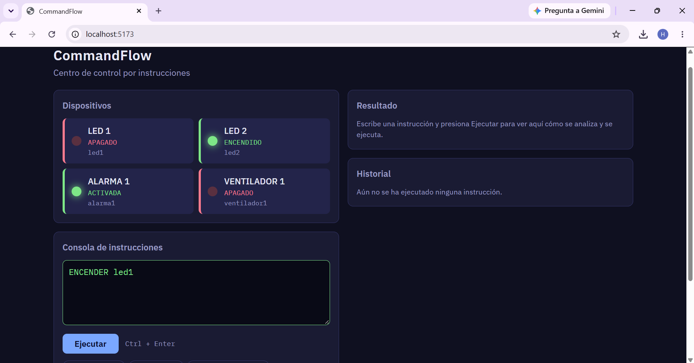
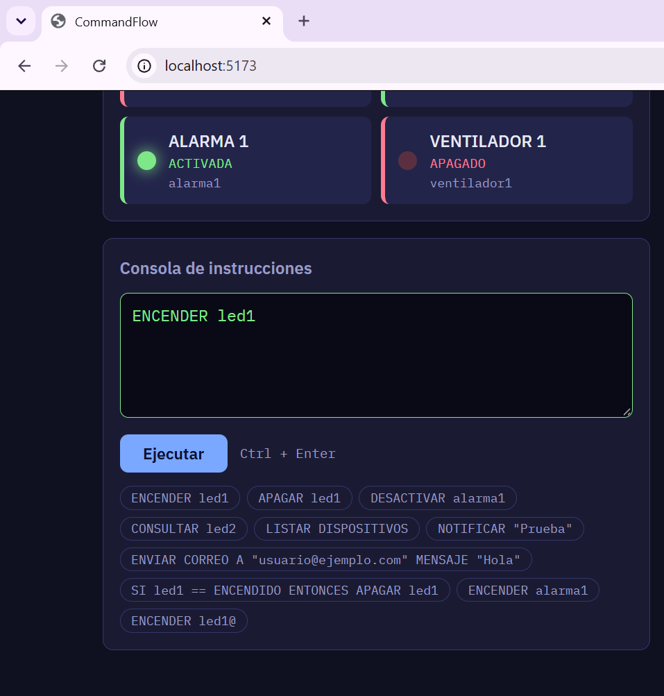
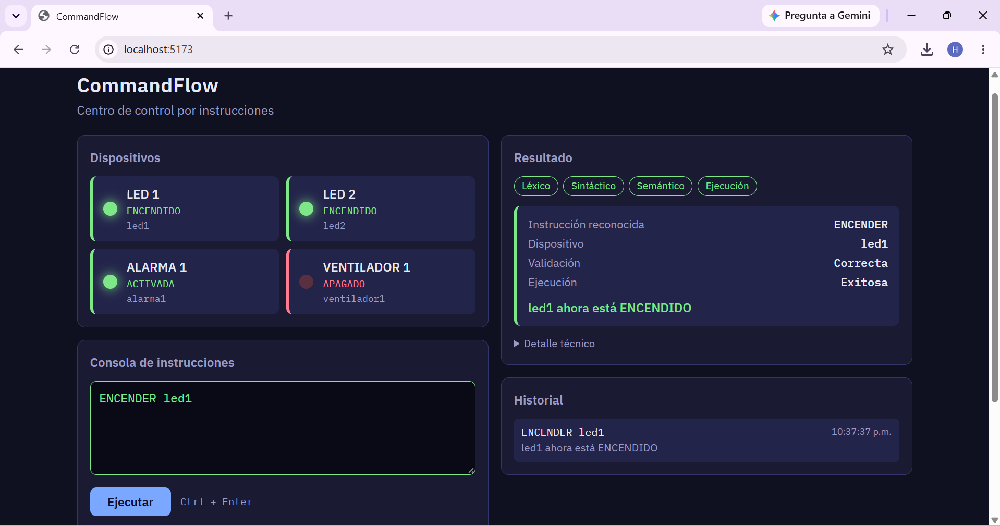
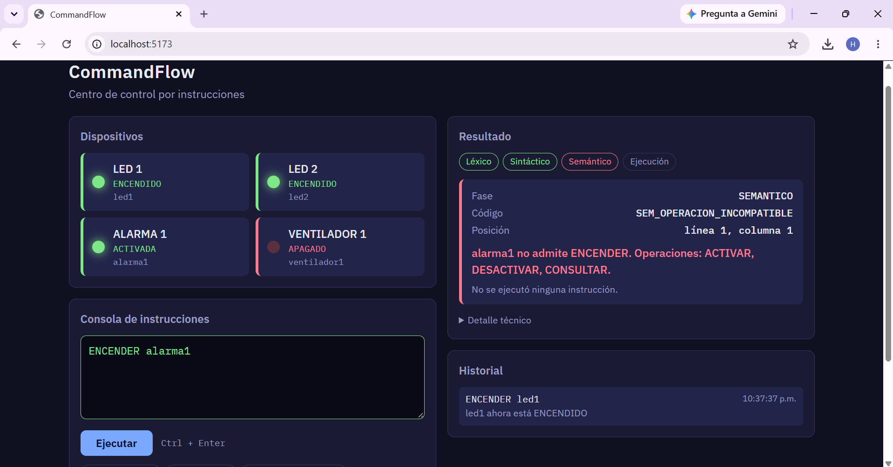
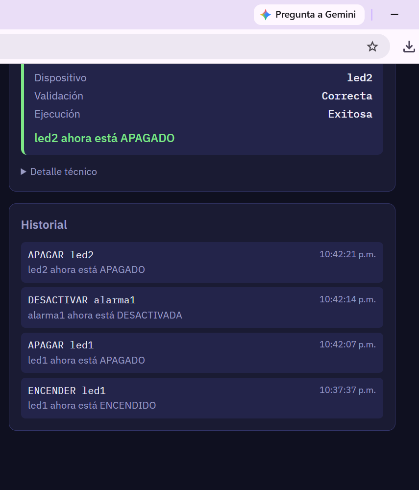

# Interfaz web (frontend)

## Descripción

La interfaz de CommandFlow es una aplicación de una sola página hecha con **React + TypeScript** y construida con **Vite**. Permite escribir instrucciones, ejecutarlas y ver su resultado, el estado de los dispositivos y el historial.

La interfaz no interpreta el lenguaje: envía el texto al backend (`POST /api/execute`) y muestra lo que este responde, siguiendo `docs/contratos.md` (sección 6).

## Estructura

```
frontend/
├── index.html
├── package.json
├── vite.config.ts          # proxy de /api hacia el backend (puerto 8000)
└── src/
    ├── main.tsx            # punto de entrada
    ├── App.tsx             # estado general y organización de los paneles
    ├── api.ts              # llamadas al backend (o al mock)
    ├── mock.ts             # backend simulado para trabajar sin API
    ├── types.ts            # tipos del contrato de la API
    ├── styles.css
    └── components/
        ├── DevicePanel.tsx   # panel de dispositivos
        ├── Console.tsx       # consola de instrucciones
        ├── ResultPanel.tsx   # panel de resultado
        └── HistoryPanel.tsx  # historial
```

## Componentes

### Panel de dispositivos
Muestra una tarjeta por dispositivo (LED 1, LED 2, ALARMA 1, VENTILADOR 1) con su estado. El indicador se enciende en verde cuando el estado es `ON` y se apaga en rosa cuando es `OFF`. Debajo del nombre aparece el identificador que se escribe en la consola (por ejemplo `led1`), porque el lenguaje no admite espacios en los identificadores.



### Consola de instrucciones
Área de texto donde se escribe una instrucción por línea. Se ejecuta con el botón **Ejecutar** o con `Ctrl + Enter`. Debajo hay botones con ejemplos de los escenarios del enunciado, que llenan la consola al presionarlos.



### Panel de resultado
Muestra el resultado de la última ejecución:

- **Fases del análisis:** léxico, sintáctico, semántico y ejecución. Las fases superadas se marcan en verde y la que falló, en rojo.
- **Ejecución correcta:** una tarjeta por instrucción con la instrucción reconocida, el dispositivo (si aplica), la validación, la ejecución y el mensaje final. En `LISTAR` se muestra la lista de dispositivos.
- **Error:** fase, código, posición (línea y columna) y mensaje. Cuando hay un error no se ejecuta ninguna instrucción del programa.
- **Detalle técnico:** sección plegable con los tokens, el AST, el IR y el IR optimizado de la respuesta.




### Historial
Lista las instrucciones ejecutadas, de la más reciente a la más antigua, con su mensaje y la hora. Guarda un registro por cada instrucción del programa original, como se define en `docs/contratos.md`.



## Flujo de uso

1. Al abrir la página se cargan los dispositivos (`GET /api/devices`) y el historial (`GET /api/history`).
2. El usuario escribe una o varias instrucciones en la consola y presiona **Ejecutar**.
3. La interfaz envía el texto a `POST /api/execute`.
4. Con la respuesta, el panel de resultado muestra el análisis y la ejecución.
5. La interfaz vuelve a pedir los dispositivos y el historial para actualizar el panel y la lista.

## Errores que muestra la interfaz

| Fase | Ejemplo | Código |
|---|---|---|
| Léxica | `ENCENDER led1@` | `LEX_CARACTER_INVALIDO` |
| Sintáctica | `ENCENDER` | `SYN_ESPERADO_IDENTIFICADOR` |
| Semántica | `ENCENDER alarma1` | `SEM_OPERACION_INCOMPATIBLE` |
| Semántica | `ENCENDER dispositivo99` | `SEM_DISPOSITIVO_NO_EXISTE` |

Si el servidor no responde, el panel de resultado muestra un mensaje de falla de conexión.

## Modos de funcionamiento

| Modo | Configuración | Uso |
|---|---|---|
| Datos simulados (por defecto) | `VITE_USE_MOCK` sin definir | Desarrollo y pruebas sin backend |
| API real | `VITE_USE_MOCK=false` en `frontend/.env.local` | Integración con FastAPI |

En desarrollo, Vite redirige las peticiones de `/api` a `http://localhost:8000`. Si el backend está en otra dirección, se define `VITE_API_URL`.

## Ejecución

```
cd frontend
npm install
npm run dev
```

La aplicación queda en `http://localhost:5173`.

## Capturas pendientes

Guardar en `docs/img/interfaz/`:

- [x] `01-dispositivos.png`: panel de dispositivos
- [x] `02-consola.png`: consola con los ejemplos
- [x] `03-resultado-correcto.png`: resultado de `ENCENDER led1`
- [x] `04-resultado-error.png`: resultado de `ENCENDER alarma1`
- [x] `05-historial.png`: historial con varias instrucciones
